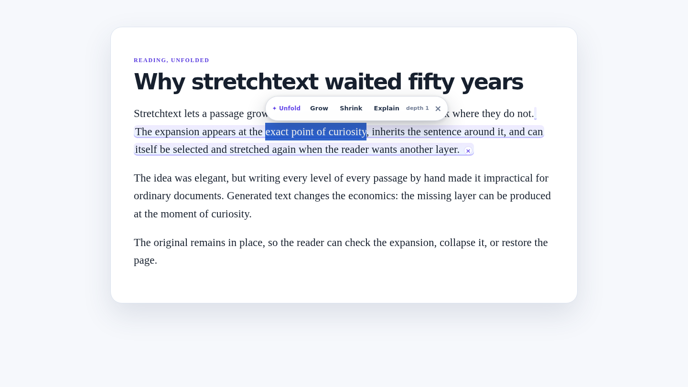

# Unfold — Stretchtext for the Web

[](https://pollinations.ai/?ref=badge)

**Unfold** brings Ted Nelson's stretchtext to ordinary web pages. Select a phrase and grow it in place. Select a wall of text and shrink it to a gist. Select jargon and explain it using the context around it. The reader pays with their own Pollen.

Built for Pollinations Quest [#17998](https://github.com/pollinations/pollinations/issues/17998).

- **Install page:** https://xiaotian1171.github.io/unfold-stretchtext/
- **Download:** https://github.com/xiaotian1171/unfold-stretchtext/releases/latest/download/unfold-stretchtext-v0.1.0.zip
- **Platform:** browser extension (Chromium and Firefox developer/unpacked install)



## Why Unfold is different

- **True stretch:** generated layers are selectable and can be grown again up to a reader-chosen depth.
- **Originals stay recoverable:** inline shrink keeps the source behind an “original” toggle; long-passage gist cards can hide or reveal the source block.
- **No chat tab detour:** expansions, gists and glosses appear in the reading flow, visibly marked and removable.
- **Key isolation:** only the background worker can read the connected API key. Content scripts receive finished text, never credentials.
- **Passage-sized cost:** nothing is sent until the reader selects an action; identical transformations can be cached locally.
- **No automatic page rewrite and no analytics.**

## How it works

1. Select reading text on any ordinary `http(s)` page.
2. Use the floating Unfold toolbar, context menu, popup or keyboard shortcuts.
3. The background worker sends only the selection plus bounded surrounding context to `gen.pollinations.ai`.
4. The result is inserted as text—never as model-supplied HTML.

Default shortcuts:

| Action | Windows/Linux | macOS |
|---|---|---|
| Grow | `Ctrl+Shift+G` | `Command+Shift+G` |
| Shrink | `Ctrl+Shift+S` | `Command+Shift+S` |
| Restore page | `Ctrl+Shift+U` | `Command+Shift+U` |

Browser-reserved shortcuts can be changed in the browser's extension shortcut settings.

## Connect Pollinations

Unfold uses the Pollinations **Device Flow**, designed for extensions and headless apps:

1. The background requests a device code using Unfold's publishable App Key (`client_id`).
2. The reader approves a scoped key at `enter.pollinations.ai/device`.
3. The background polls for the resulting `sk_...` key and stores it in extension-local storage.
4. Generation calls use that reader's key, so the reader's Pollen pays.

A manual-key fallback is available in Settings for reviewers and power users. It uses the same background-only storage boundary.

### Developer App Key setup

`UNFOLD_APP_KEY` in `extension/background.js` must contain the publishable `pk_...` App Key for Device Flow attribution. Publishable keys are not secrets. Secret `sk_...` keys must never be committed.

## Install

### Chrome, Edge or Brave

1. Download and unzip the release.
2. Open `chrome://extensions` (or the equivalent extensions page).
3. Enable Developer mode.
4. Choose **Load unpacked** and select the unzipped folder (the folder containing `manifest.json`).
5. Open Unfold Settings and connect Pollinations.

### Firefox

1. Download and unzip the release.
2. Open `about:debugging#/runtime/this-firefox`.
3. Choose **Load Temporary Add-on** and select `manifest.json`.
4. Open Unfold Settings and connect Pollinations.

Firefox removes temporary add-ons at restart; a signed store build would be needed for permanent Firefox installation.

## Privacy

- Selection observation happens locally. A network request occurs only after Grow, Shrink or Explain.
- The request contains the selected text, a bounded surrounding context for sense, the page title, the chosen action/model and stretch depth.
- The API key is stored in extension-local storage and read only by the background worker.
- Cached transformations are stored locally and can be cleared in Settings.
- Unfold does not run in text fields, includes no analytics, and does not send browsing history.

## Development

```bash
npm test
npm run package
npm run serve:site
```

- `npm test` syntax-checks the extension scripts and runs the core/manifest test suite.
- `npm run package` creates a deterministic ZIP in `dist/` and prints its SHA-256.
- The install site is a static GitHub Pages site under `docs/`; its demo is explicitly canned and makes no API call.

Repository layout:

```text
extension/   Manifest V3 extension (this folder is the ZIP root)
docs/        Install and interactive demo site
tests/       Node core and contract tests
scripts/     Deterministic packaging
assets/      Submission screenshot
```

## License

MIT
